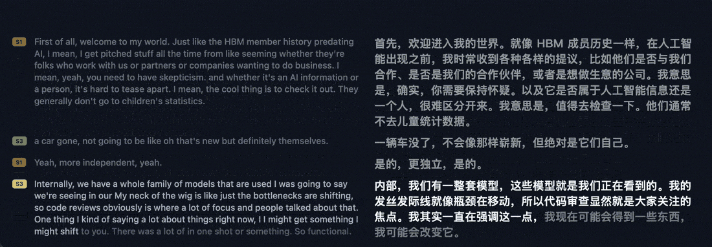
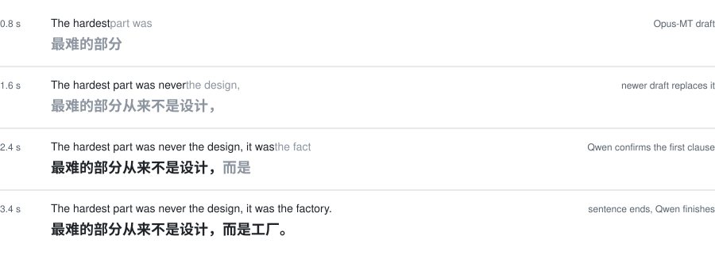
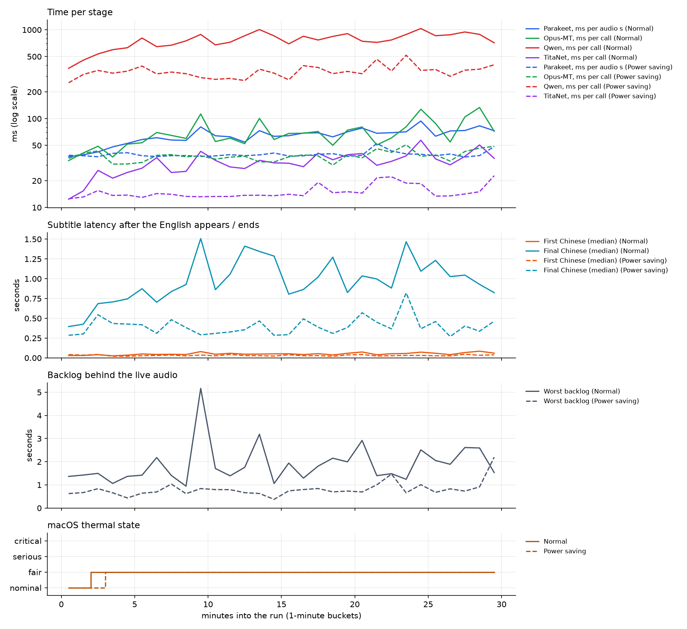

<p align="center">
  
</p>

<p align="center">
  <a href="LICENSE"></a>
  
  <a href="https://undertext.leo-draw.xyz/en/"></a>
</p>

<p align="center"><a href="https://undertext.leo-draw.xyz/en/"><b>Website</b></a> | <a href="https://undertext.leo-draw.xyz/">中文网站</a> | <a href="../../releases/latest">Download</a></p>

<p align="center">English | <a href="README.zh-CN.md">简体中文</a></p>

UnderText shows live English subtitles with a Chinese translation underneath, in a small window that stays on top of whatever you are watching. Speech recognition, translation and speaker detection all run on the Mac. Nothing is sent over the network.

<p align="center">
  
</p>
<p align="center"><sub>Recorded on a MacBook Air M4, side-by-side layout. The faded words are still being recognised or translated.</sub></p>

You can caption your microphone, a WAV file, or anything playing on your Mac (Zoom, Teams, YouTube) by routing the sound through [BlackHole](https://github.com/ExistentialAudio/BlackHole). The Chinese shows up before the speaker has finished the sentence. Each speaker gets a label (S1, S2, …), and a new paragraph starts when the speaker changes or pauses. If you use it for hours on a MacBook Air, turn on power saving to keep it cool.

## How it works

<p align="center">
  
</p>

### Speech to English

Audio is read as 16 kHz mono chunks. Silero VAD marks where speech starts and stops. A segment ends after 0.4 s of silence, or is cut at 20 s if nobody pauses.

While a segment is open, Parakeet-TDT transcribes the whole segment again every 0.5 s. If one run takes longer than that, the next run waits longer, so recognition never falls behind the audio. A word turns white once two runs in a row agree on it. The words after it stay grey and can still change.

The text is cut into sentences at a full stop, question mark or exclamation mark, at the end of a segment, or after 40 words.

### English to Chinese

Each sentence gets three kinds of translation:

- **Draft.** Opus-MT translates the sentence so far, grey words included, on the CPU. Each new draft replaces the previous one.
- **Continuation.** After every 3 newly confirmed words, or when a clause ends with a comma, semicolon, colon or dash, Qwen3.5-2B (llama-server on the GPU) receives the confirmed English, the previous 3 sentences as context, and the Chinese confirmed so far as the beginning of its answer. It can only write after that beginning, so text already on screen is never rewritten. Chinese characters that two answers in a row agree on are confirmed, and from then on the draft is hidden.
- **Final.** When the sentence ends, Qwen gets the complete sentence and writes the rest of the translation after the confirmed Chinese.

<p align="center">
  
</p>

### Speakers and display

TitaNet turns speech into a voice print and compares it with the speakers heard so far. While someone talks, it checks the last 1.5 s of audio every 1.5 s, so a known speaker is labelled about 1.5 s after they start. A voice that matches nobody (similarity below 0.45) becomes a new speaker once it has been heard consistently for about 4.5 s. When the segment ends, it is checked again in 1.5 s windows; this catches a change of speaker without a pause and corrects the labels if needed.

A new paragraph starts when the speaker changes or after a pause of 1.2 s. The subtitle window gets only the paragraphs that changed, at most 10 times a second. **Save** (保存) writes everything since the last **Clear** (清空) to a text file, with a real timestamp for each paragraph.

Power saving changes some of these numbers: Qwen is called after 5 new words instead of 3 and gets 1 sentence of context instead of 3, and long segments are transcribed less often.

## Models

| Role | Model | Runs on | Size | License |
|---|---|---|---|---|
| Voice activity | [Silero VAD](https://github.com/snakers4/silero-vad) | sherpa-onnx | 0.6 MB | MIT |
| Speech recognition | [Parakeet-TDT 0.6B v2](https://huggingface.co/nvidia/parakeet-tdt-0.6b-v2), int8 | sherpa-onnx | 630 MB | CC-BY-4.0 |
| Speaker labels | [TitaNet-small](https://catalog.ngc.nvidia.com/orgs/nvidia/teams/nemo/models/titanet_small) | sherpa-onnx | 39 MB | NeMo license |
| Draft translation | [Opus-MT en-zh](https://huggingface.co/Helsinki-NLP/opus-mt-en-zh) | CTranslate2 (CPU) | 150 MB | Apache-2.0 |
| Translation | [Qwen3.5-2B](https://huggingface.co/Qwen/Qwen3.5-2B), Q4_K_M | llama-server (GPU) | 1.2 GB | Apache-2.0 |

The models are not in this repository. They are kept in the project's own repositories on [Hugging Face](https://huggingface.co/funnyQZQ/undertext-models) and [ModelScope](https://modelscope.cn/models/funnyqzq/undertext-models). The app downloads them on first launch; for source builds there is also a download script (see [Installation](#installation)).

## Installation

You need a Mac with Apple Silicon (M1 or later). The models take about 2.2 GB of disk space.

### Install from .dmg file

1. Download the `.dmg` from the [Releases](../../releases/latest) page.
2. Open it and drag **UnderText** into **Applications**.
3. The app is not signed by Apple, so macOS blocks the first launch. Right-click UnderText in Applications and choose **Open**, then **Open** again. If that doesn't work, go to **System Settings → Privacy & Security** and click **Open Anyway**.
4. On first launch the settings window opens and lists the models it needs, with their sizes. Click **下载** (Download). The app interface is in Chinese. `llama-server` (from llama.cpp, which runs the translation model) is included in the app, so only the models are downloaded. The app tests Hugging Face and ModelScope and uses the faster one; ModelScope needs no VPN in mainland China. If neither can be reached, the dialog lists the missing files, with buttons that open both download pages and the models folder: download the files by hand, put them in the models folder with the same subfolders, and click **重新检查** (Check again).
5. When the download finishes, choose where to listen and click **保存并重新开始** (Save and Restart).

The models are saved in `~/Library/Application Support/dev.undertext.desktop/models`. If the download stops, click **下载…** (Download…) in the settings window to continue; files that are already complete are not downloaded again.

### Build from source

You need [Rust](https://rustup.rs) and Homebrew.

```bash
brew install llama.cpp cmake
cd desktop
scripts/download_models.sh        # saves to ../models; MODELS_FROM=modelscope for ModelScope
cargo run --release -p undertext-app
```

To build the `.app` and `.dmg` yourself (this also puts the llama.cpp release build of `llama-server` into the app):

```bash
cargo install tauri-cli --version "^2"
cd app/src-tauri && cargo tauri build      # output in desktop/target/release/bundle/
```

[desktop/README.md](desktop/README.md) covers build problems and `undertext-cli`, which runs the same pipeline in the terminal for testing and long runs.

## Performance

Two 30-minute runs on a MacBook Air M4 (16 GB, no fan) with translation and speaker labels on: one with the default settings, one with power saving.

<p align="center">
  
</p>

| | Default | Power saving |
|---|---:|---:|
| Parakeet-TDT, ms per second of audio | 63 | 40 |
| Opus-MT, ms per call (p50 / p90) | 55 / 121 | 34 / 60 |
| Qwen3.5-2B, ms per call (p50 / p90) | 730 / 1070 | 313 / 494 |
| TitaNet, ms per call (p50 / p90) | 25 / 38 | 11 / 17 |
| Final Chinese after the sentence ends, s (p50 / p90) | 0.92 / 1.89 | 0.37 / 0.76 |
| Backlog behind the live audio, s (p50 / p90) | 0.94 / 1.89 | 0.43 / 0.73 |

Both runs reached the "fair" thermal state within 3 minutes. The Opus-MT draft appears together with the English (median under 0.1 s) in both. With the default settings Qwen is busy 69% of the time, its calls get about 40% slower over the run, and the backlog grows from 1.5 s to 2 s. Power saving sends shorter prompts less often (Qwen busy 25%), stays almost flat, and halves the latency, so it is the better choice for long sessions on a MacBook Air. [docs/performance.md](docs/performance.md) explains how to run the test.

## Acknowledgements

UnderText is built on:

- [sherpa-onnx](https://github.com/k2-fsa/sherpa-onnx) and [ONNX Runtime](https://github.com/microsoft/onnxruntime) for speech recognition, VAD and speaker embeddings
- [llama.cpp](https://github.com/ggml-org/llama.cpp) for the translation model
- [CTranslate2](https://github.com/OpenNMT/CTranslate2), [ct2rs](https://github.com/jkawamoto/ctranslate2-rs) and [sentencepiece-rust](https://crates.io/crates/sentencepiece-rust) for Opus-MT
- [Tauri](https://tauri.app) for the app
- [cpal](https://github.com/RustAudio/cpal) and [hound](https://github.com/ruuda/hound) for audio

and on models from [NVIDIA NeMo](https://github.com/NVIDIA/NeMo), [Qwen](https://github.com/QwenLM), [Helsinki-NLP](https://github.com/Helsinki-NLP/Opus-MT) and [Silero](https://github.com/snakers4/silero-vad).

## License

The code is under the [MIT License](LICENSE). The models have their own licenses, listed above.
